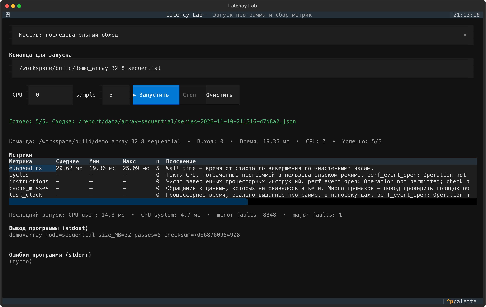
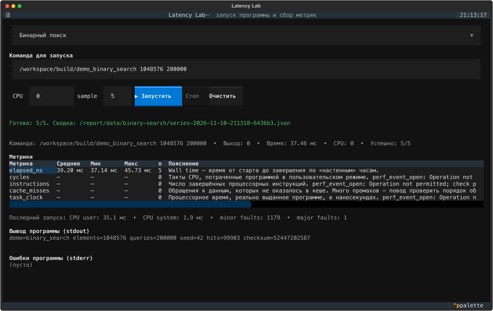
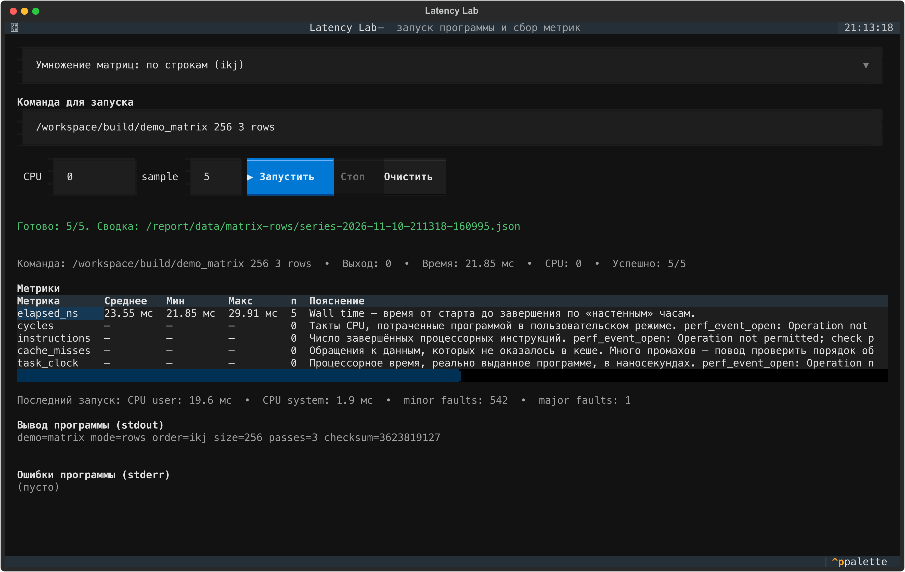

# Демонстрационные запуски 10 ноября 2026 года

Пять демо запущены через настоящий Python TUI, C++ runner и MetricsCollector. Для каждого выполнено 5 успешных запусков на логическом CPU 0 — всего 25 запусков. Исходная версия кода: 0e0379d.

Среда: Linux-контейнер внутри VM на macOS, aarch64, Python 3.12.13, Textual 8.2.8. Подробности: [environment.json](environment.json).

Аппаратные perf-счётчики в этой среде запрещены. Прочерки и n=0 на экране означают отсутствие измерения, а не нулевое число событий. Время и resource counters измерены реально. По этим данным нельзя подтвердить аппаратную причину замедления.

Время включает запуск процесса, инициализацию, алгоритм, checksum и вывод. CPU не зарезервирован исключительно для теста. Это иллюстрация работы прототипа в указанной среде.

## Результаты

| Демо и PNG | Среднее, мс | Минимум, мс | Максимум, мс | Исходная сводка |
| --- | ---: | ---: | ---: | --- |
| [Массив: последовательный обход](01-array-sequential.png) | 20.62 | 19.36 | 25.09 | [JSON](data/array-sequential/series-2026-11-10-211316-d7d8a2.json) |
| [Массив: обход с большим шагом](02-array-strided.png) | 84.62 | 78.09 | 89.25 | [JSON](data/array-strided/series-2026-11-10-211317-fb771d.json) |
| [Бинарный поиск](03-binary-search.png) | 39.20 | 37.14 | 45.73 | [JSON](data/binary-search/series-2026-11-10-211318-6436b3.json) |
| [Умножение матриц: по строкам (ikj)](04-matrix-rows.png) | 23.55 | 21.85 | 29.91 | [JSON](data/matrix-rows/series-2026-11-10-211318-160995.json) |
| [Умножение матриц: по столбцам (ijk)](05-matrix-columns.png) | 40.62 | 39.52 | 44.64 | [JSON](data/matrix-columns/series-2026-11-10-211319-3c4cfa.json) |

Контрольные суммы двух обходов массива совпали. Контрольные суммы двух вариантов умножения матриц также совпали.

[Общие результаты](results.json), [подписи для отчёта](captions.txt). PNG имеют разрешение 3550 × 2247; рядом лежат SVG-версии. В data/ сохранены все исходные запуски и сводки.

Скриншоты экспортированы из реального экрана Textual после выполнения процессов. PNG получены рендерингом SVG; значения не редактировались.

## Скриншоты

### Массив: последовательный обход

Команда: `/workspace/build/demo_array 32 8 sequential`.

[SVG](01-array-sequential.svg) · [Сводка JSON](data/array-sequential/series-2026-11-10-211316-d7d8a2.json)

### Массив: обход с большим шагом

Команда: `/workspace/build/demo_array 32 8 strided`.

[SVG](02-array-strided.svg) · [Сводка JSON](data/array-strided/series-2026-11-10-211317-fb771d.json)

### Бинарный поиск

Команда: `/workspace/build/demo_binary_search 1048576 200000`.

[SVG](03-binary-search.svg) · [Сводка JSON](data/binary-search/series-2026-11-10-211318-6436b3.json)

### Умножение матриц: по строкам (ikj)

Команда: `/workspace/build/demo_matrix 256 3 rows`.

[SVG](04-matrix-rows.svg) · [Сводка JSON](data/matrix-rows/series-2026-11-10-211318-160995.json)

### Умножение матриц: по столбцам (ijk)

Команда: `/workspace/build/demo_matrix 256 3 columns`.

[SVG](05-matrix-columns.svg) · [Сводка JSON](data/matrix-columns/series-2026-11-10-211319-3c4cfa.json)
