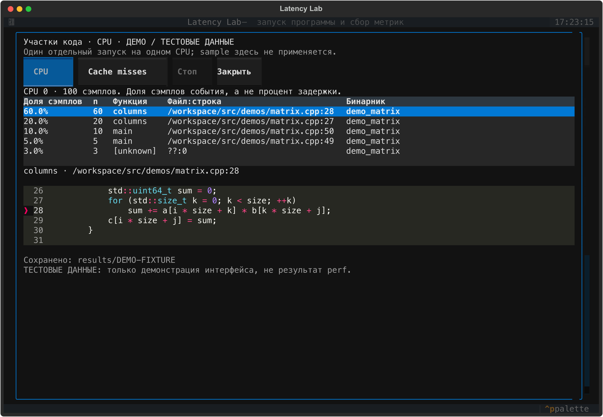
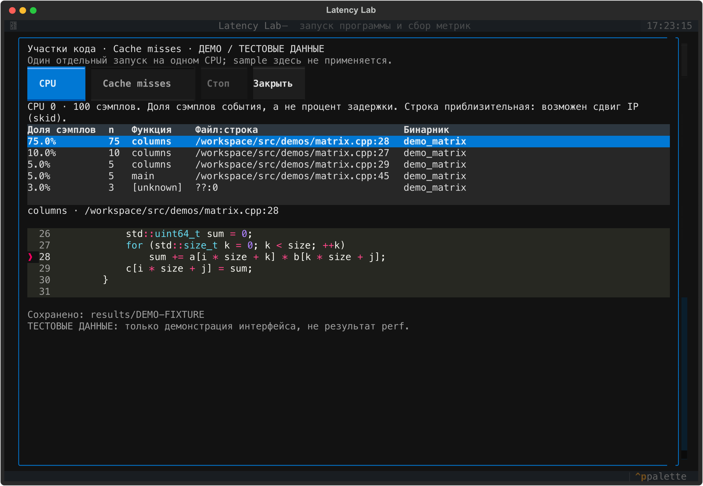
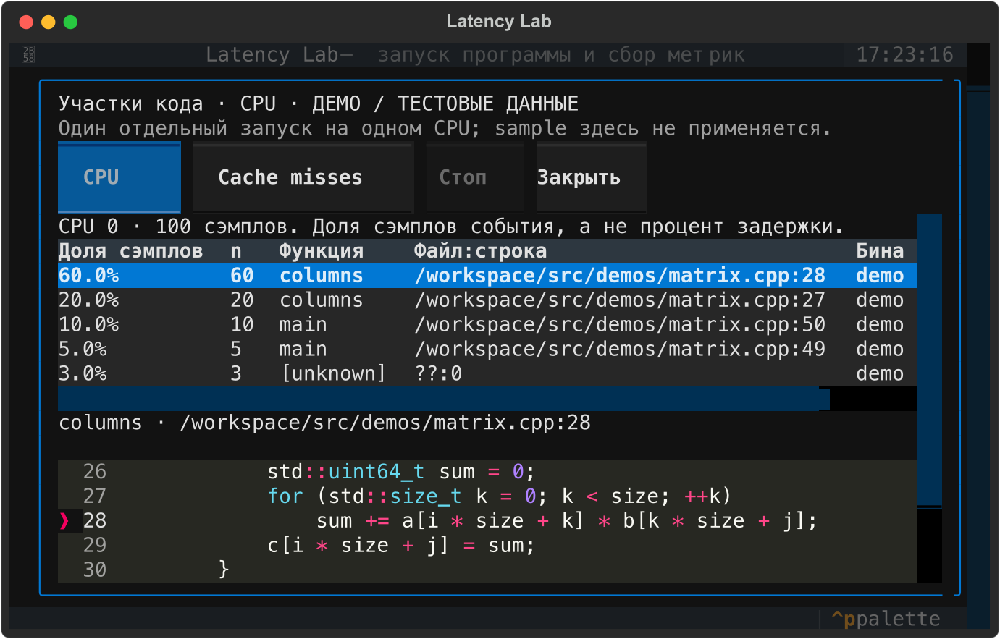

# Экран «Участки кода»

Скриншоты настоящего Textual-интерфейса из PR #5. **Все числа — синтетические
тестовые данные для демонстрации интерфейса, а не измерения CPU/cache misses.**
Эта пометка также находится в заголовке каждого изображения.
Фрагмент исходника читается из `src/demos/matrix.cpp`.

## CPU, 120×40

Топ-5 мест, функция, файл и пять строк исходника с подсветкой выбранной строки.



## Cache misses, 120×40

Отдельный режим с предупреждением о приблизительной привязке события к строке.



## Небольшой терминал, 80×24

Выбранная строка видна; таблица и область результатов поддерживают прокрутку.



## Воспроизведение

В корне проекта с установленными Python-зависимостями:

```bash
PYTHONPATH=. python3 docs/screenshots/hotspots/capture.py
```

Скрипт открывает приложение через Textual Pilot, подставляет явную тестовую
фикстуру на границе профилировщика и сохраняет SVG. Бинарник и perf не запускаются.
PNG отрендерены из SVG через Sharp с density=100. Перед публикацией проверена
читаемость обоих размеров терминала. Изменений кода приложения для съёмки нет.
